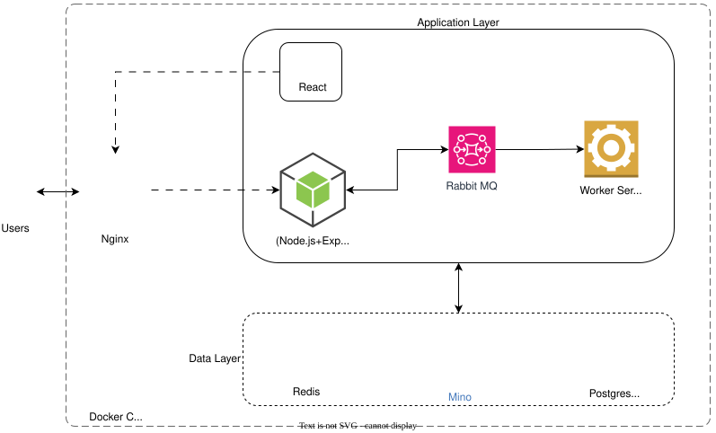

# DAM

Digital Asset Management (DAM) Platform. Companies today generate and manage a large volume of digital assets — including images, videos, and documents — across multiple teams, projects, and marketing channels.



## **Repository structure**

```
.
├── NodeBackend/
│   ├── Dockerfile
│   ├── package.json
│   ├── tsconfig.json
│   ├── _test_/
│   └── src/
│       ├── config/
│       ├── controllers/
│       ├── middleware/
│       ├── models/
│       ├── routes/
│       ├── services/
│       ├── types/
│       └── utils/
├── ReactFrontend/
│   ├── Dockerfile
│   ├── package.json
│   ├── tsconfig.json
│   ├── babel.config.ts
│   ├── nginx.config
│   ├── public/
│   ├── src/
│   │   ├── assets/
│   │   ├── components/
│   │   ├── context/
│   │   ├── hooks/
│   │   ├── pages/
│   │   ├── reducers/
│   │   ├── routes/
│   │   ├── services/
│   │   ├── store/
│   │   ├── styles/
│   │   └── types/
│   └── _test_/
├── worker/
│   ├── Dockerfile
│   ├── package.json
│   ├── tsconfig.json
│   └── src/
│       ├── config/
│       ├── models/
│       ├── services/
│       ├── types/
│       └── utils/
├── packages/
│   └── shared-types/
│       └── index.d.ts
├── db/
│   └── init.sql
├── minio/
│   ├── minio.license
│   ├── certs/
│   └── data/
├── docker-compose.yml
├── package.json
└── README.md
```

## **Prerequisites**

- Docker Desktop or Docker Engine installed
- Docker Compose support (`docker compose`)
- Git installed for cloning the repository
- Node.js and npm for local development

## **Local development**

Install dependencies once from the repository root; npm workspaces share the root installation and lockfile:

```bash
npm install
```

The root manifest owns the `pg-promise`, `minio`, `winston`, and `amqplib` dependencies used by both the backend and worker. Their shared asset and media-task contracts are maintained in `packages/shared-types`.

Start an application from the root:

```bash
npm run react
npm run node
npm run worker
```

## **Local Docker deployment**

1. Copy the example environment file and provide strong local or production
   values for every blank secret/origin. Never commit `.env`:
   ```bash
   cp .env.example .env
   ```
   On PowerShell, use `Copy-Item .env.example .env`.
2. Clone the repository if needed, then build and start all services:
   ```bash
   docker compose up -d --build
   ```
   Or use the root convenience script:
   ```bash
   npm run composeup
   ```
3. Validate the services:
   - Frontend: http://localhost
   - Backend: http://localhost:3002
   - MinIO console: http://localhost:9001
   - RabbitMQ management: http://localhost:15672

## **Stop and remove containers**

```bash
docker compose down
```

Or:

```bash
npm run composedown
```

## **Configuration notes**

- `docker-compose.yml` defines the multi-service stack: `frontend`, `backend`, `worker`, `postgres`, `minio`, and `rabbitmq`.
- `.env` provides compose-time credentials and service configuration; `.env.example` contains placeholders only.
- PostgreSQL runs initialization as the separate `POSTGRES_USER` administrator; the init script provisions `DB_USER` with application table/sequence grants for backend and worker access.
- The backend and worker receive database, RabbitMQ, and MinIO connection settings from Compose. Set `CORS_ORIGINS` to the exact browser-facing origin(s), and set `MINIO_PUBLIC_URL` to the public site origin.
- Generate unique secrets for production. The PostgreSQL and RabbitMQ passwords are embedded in connection URLs, so use URL-safe values (for example, hex-encoded random secrets).
- PostgreSQL, MinIO, and RabbitMQ host ports bind to loopback only. Public traffic should go through a TLS-terminating reverse proxy in front of the included HTTP Nginx service.
- Database initialization happens from `db/init.sql`.
- MinIO uses `minio/minio.license`, `minio/certs`, and mounted `minio_data` volume.

## **Production images and release flow**

GitHub Actions runs the workspace build and test suites for every branch push
and pull request. A successful push to `main` or `production` additionally
builds and publishes these images to GitHub Container Registry (GHCR):

- `ghcr.io/kishanmfs/dam-frontend`
- `ghcr.io/kishanmfs/dam-backend`
- `ghcr.io/kishanmfs/dam-worker`

Each release is tagged `latest`, with its branch and commit SHA tags also
available. Publishing images does not deploy them to a server. A repository
administrator must grant the deployment host permission to pull private GHCR
packages (or make the packages public).

On the production host, check out the repository for the Compose file, Nginx
configuration, and database initialization script. Create and secure its
`.env` file, install the MinIO license/certificates, authenticate to GHCR if the
packages are private, then pull and start the published images:

```bash
docker login ghcr.io
docker compose pull frontend backend worker
docker compose up -d --no-build
```

For reproducible rollbacks, set `IMAGE_TAG=sha-<commit>` in `.env` instead of
using `latest` before running `docker compose pull` and `docker compose up`.
Initialization scripts run only for a new PostgreSQL data volume. For an
existing volume, provision the `DB_USER` role and required grants manually
before switching the applications to it. Changing administrator or application
credentials requires a database credential migration and must not be treated as
an automatic rotation.

## **Docker service ports**

- `80` -> frontend
- `3002` -> backend
- `5432` -> PostgreSQL
- `9000` -> MinIO API
- `9001` -> MinIO console
- `5672` -> RabbitMQ AMQP
- `15672` -> RabbitMQ management

## **Backend API endpoints**

The Node backend exposes the following REST endpoints under the base URL `http://localhost/api` when running locally via Docker. Direct backend access is available at `http://localhost:3002/api`.

> Protected endpoints require a valid `access_token` cookie unless noted otherwise.

| Endpoint                             | Method   | Description                                                                      |
| ------------------------------------ | -------- | -------------------------------------------------------------------------------- |
| `/api/auth/login`                    | `POST`   | Authenticates a user with email and password and sets the access token cookie.   |
| `/api/auth/logout`                   | `POST`   | Clears the authentication cookie and ends the current session.                   |
| `/api/auth/verify`                   | `GET`    | Verifies whether the current access token is valid.                              |
| `/api/assets`                        | `POST`   | Uploads asset metadata for a new asset. Requires authentication.                 |
| `/api/assets`                        | `GET`    | Retrieves the list of assets for the current user or all assets for admin users. |
| `/api/assets/presigned-url`          | `POST`   | Requests a pre-signed URL for direct upload of an asset to storage.              |
| `/api/assets/dashboard`              | `GET`    | Returns dashboard statistics for the DAM application.                            |
| `/api/assets/:fileId/download-count` | `PATCH`  | Increments the download count for a specific asset file.                         |
| `/api/assets/:fileId`                | `DELETE` | Deletes an asset and its generated variants; admin access required.              |

## **Recommended development flow**

1. Start the stack with `docker compose up -d --build`.
2. Open the frontend in your browser.
3. Use RabbitMQ management and MinIO console for diagnostics.
4. Update environment configuration files before rebuilding if credentials or hosts change.
